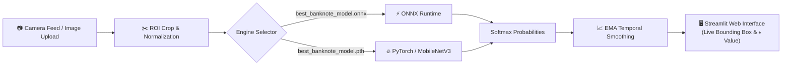

<div align="center">

# ৳ Taka Scanner
### Real-Time Bangladeshi Banknote Recognition & Classification

[](https://python.org)
[](https://streamlit.io)
[](https://pytorch.org)
[](https://onnxruntime.ai)
[](https://opencv.org)
[](https://webrtc.org)

<p align="center">
  <b>A lightweight, ultra-fast computer vision web app to detect and identify Bangladeshi banknotes in real-time through live camera feeds or photo uploads.</b>
</p>

[Key Features](#-key-features) •
[Supported Denominations](#-supported-denominations) •
[Architecture](#-system-architecture) •
[Quickstart](#-quickstart) •
[Deployment](#-deployment) •
[Configuration](#-sidebar-controls)

</div>

---

## 🌟 Key Features

- **⚡ Real-Time WebRTC Video Stream**: Zero-latency webcam streaming powered by `streamlit-webrtc` and `av` with asynchronous frame processing.
- **🧠 Dual Inference Engine**:
  - **ONNX Runtime (CPU)**: Lightweight, thread-optimized inference for production deployment.
  - **PyTorch / timm (Fallback)**: Native support for MobileNetV3 `.pth` checkpoints.
- **🎯 Smart Temporal Smoothing (EMA)**: Exponential Moving Average across frames eliminates flickering and provides stable, jitter-free predictions.
- **📦 Dynamic Region of Interest (ROI)**: Guiding bounding box with adjustable dimensions allows clean note cropping even in cluttered environments.
- **📸 Dual Input Modes**:
  - **Live Camera**: Continuous real-time detection with on-screen bounding boxes and live FPS/latency stats.
  - **Photo / Upload Mode**: Capture directly with mobile/desktop camera or upload existing images (`.jpg`, `.png`, `.webp`) with top-5 confidence ranking distributions.
- **🇧🇩 Bilingual Display**: Displays detected currency denominations in both English and native Bengali script.

---

## 🇧🇩 Supported Denominations

The model is trained to classify all standard legal tender banknotes issued by the Bangladesh Bank:

| Note | Denomination | Bengali Script | Model Target |
|:---:|:---:|:---:|:---:|
| 🪙 | **৳ 2** | দুই টাকা | `2` |
| 🪙 | **৳ 5** | পাঁচ টাকা | `5` |
| 💵 | **৳ 10** | দশ টাকা | `10` |
| 💵 | **৳ 20** | বিশ টাকা | `20` |
| 💵 | **৳ 50** | পঞ্চাশ টাকা | `50` |
| 💶 | **৳ 100** | একশো টাকা | `100` |
| 💶 | **৳ 200** | দুইশো টাকা | `200` |
| 💷 | **৳ 500** | পাঁচশো টাকা | `500` |
| 💷 | **৳ 1000** | এক হাজার টাকা | `1000` |

---

## 🔬 System Architecture



---

## 🚀 Quickstart

### 1. Prerequisites
- **Python**: 3.10, 3.11, or 3.12 installed
- **Webcam / Camera**: Required for live detection mode

### 2. Clone the Repository
```bash
git clone https://github.com/your-username/note-detection.git
cd note-detection
```

### 3. Install Dependencies
```bash
pip install -r requirements.txt
```

> [!TIP]
> If you are using the PyTorch checkpoint (`best_banknote_model.pth`), ensure `torch` and `timm` are installed:
> ```bash
> pip install torch torchvision timm
> ```

### 4. Run the Application
```bash
streamlit run app.py
```
Open your browser at `http://localhost:8501`.

---

## 📂 Project Structure

```plaintext
Note detection/
├── app.py                         # Streamlit application with WebRTC processor
├── requirements.txt               # Project dependencies
├── best_banknote_model.pth        # Trained PyTorch weights (MobileNetV3)
├── best_banknote_model.onnx       # Optional: High-speed ONNX model (recommended)
├── best_banknote_model.meta.json  # Optional: Model metadata & normalization parameters
├── .gitignore                     # Git ignore rules for Python & Streamlit
└── README.md                      # Project documentation
```

---

## 🎛️ Sidebar Controls

Customize inference parameters on the fly via the collapsible sidebar:

| Parameter | Default | Range | Description |
|:---|:---:|:---:|:---|
| **Minimum confidence** | `0.60` | `0.30 - 0.95` | Threshold required to confirm banknote detection |
| **Smoothing (EMA)** | `0.50` | `0.0 - 0.90` | Exponential moving average factor across frames |
| **Run model every N frames** | `2` | `1 - 6` | Frame skipping to reduce CPU consumption |
| **Use whole frame** | `Disabled` | `True / False` | Toggle between centered ROI box or full frame scan |
| **Box width / height** | `0.80 / 0.60` | `0.4 - 1.0` | Custom framing dimensions for the banknote guide |

---

## 🌐 Deployment (Streamlit Community Cloud)

1. Push your repository to **GitHub**.
2. Visit **[share.streamlit.io](https://share.streamlit.io/)** and sign in.
3. Click **"New app"** and select:
   - **Repository**: `your-username/note-detection`
   - **Branch**: `main`
   - **Main file path**: `app.py`
4. Click **Deploy!**

> [!NOTE]
> For optimal mobile network connectivity over WebRTC on public clouds, you can optionally supply custom **STUN/TURN** server credentials under `.streamlit/secrets.toml`:
> ```toml
> [turn]
> url = "turn:your-turn-server.com:3478"
> username = "your-username"
> credential = "your-password"
> ```

---

## 🛡️ License

This project is licensed under the [MIT License](LICENSE) — feel free to modify and use it for research, educational, or commercial projects.

<div align="center">
  <sub>Built with ❤️ for Bangladesh 🇧🇩</sub>
</div>

